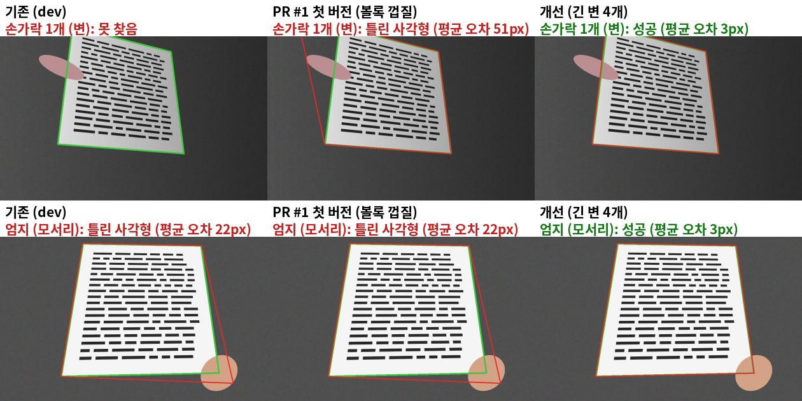

# [detect] 손가락·모서리 가림에서의 문서 검출 (대안 단계 비교)

- 담당 / 날짜: 신승준 / 11.25
- 질문: 문서를 손으로 잡거나 모서리가 접혀 윤곽이 4각형으로 근사되지 않을 때도 꼭짓점을 찾을 수 있는가, 그러면서 문서가 아닌 물체를 잘못 잡지는 않는가
- 방법: `python experiments/detect_occlusion.py --synthetic` (처리 해상도 480px, 엣지는 dev 의 Otsu Canny)
  - 조건별 합성 세트 60장 (`make_condition_set`, 한시원 실험과 같은 세트)
  - 가림 세트: 문서 위치·각도를 무작위로 한 합성 사진에 손가락 1개·2개(변), 엄지(모서리), 접힌 모서리를 넣어 장면당 40장. 손가락은 절반은 피부색, 절반은 어두운 색
  - 문서 없는 장면: 빈 배경·원/타원 물체·무늬 배경 각 40장, 그 밖에 삼각형~팔각형·반원·둥근 사각형·L자·불규칙한 덩어리 각 40장
  - 성공: 꼭짓점 평균 오차 ≤ 문서 대각선의 2% (`evaluate.py` 와 같은 기준). **틀린 사각형** = 무언가 잡았지만 기준을 넘은 경우. 화면에 엉뚱한 사각형이 뜨고 자동 촬영까지 될 수 있어 '못 찾음'보다 나쁘다
  - 비교: dev(4각형 근사만) / PR #1 첫 버전(볼록 껍질 근사) / 개선(긴 변 4개로 복원)

## 결과

| 장면 | dev | 첫 버전 (볼록 껍질) | **개선 (긴 변 4개)** |
|---|---|---|---|
| 조건별 세트 60장 | 53 | 53 (틀림 4) | **59** |
| └ 손가림 6장 | 0 | 0 (틀림 4) | **6** |
| 가림 없음 40장 | 40 | 40 | 40 |
| 손가락 1개 (변) 40장 | 6 | 21 (틀림 10) | **40** |
| 손가락 2개 (변) 40장 | 0 | 9 (틀림 19) | **40** |
| 엄지 (모서리) 40장 | 3 (틀림 10) | 21 (틀림 19) | **40** |
| 접힌 모서리 40장 (평균 오차) | 40 (8.8px) | 40 (8.8px) | 40 (**3.5px**) |
| 문서 없는 장면 120장 오검출 | 0 | 0 | 0 |
| 문서가 아닌 도형 320장 오검출 | – | – | 0 |
| find_document 시간 (PC, 480px) | 0.06ms | 0.16ms | 0.45ms |

- 조건별 세트에서 남은 1장은 비슷한색배경으로, 엣지 단계에서 경계가 끊긴 경우다.

## 해석

- **dev**: 손가락이 변을 가리면 윤곽이 파이거나 튀어나와 4각형으로 근사되지 않아 못 찾는다. 엄지가 모서리를 덮으면 엄지 끝을 꼭짓점으로 삼은 틀린 사각형이 나온다.
- **첫 버전 (볼록 껍질 근사)**: 어두운 손가락(변이 파임)은 해결했지만, **피부색 손가락은 종이처럼 배경보다 밝아서 윤곽이 손가락까지 이어진다.** 볼록 껍질이 손가락 끝까지 감싸면서 사각형이 바깥으로 끌려 나갔다. 찾은 수는 늘었지만 틀린 사각형도 늘었다.
- **개선 (긴 변 4개로 복원)**: 윤곽선을 촘촘히 근사해 선분으로 나누고, 같은 직선 위의 선분끼리 묶어 가장 긴 직선 4개를 네 변으로 본다. 이웃한 두 변의 교점이 꼭짓점이다. 손가락이 변을 가려도 변의 나머지 부분은 같은 직선 위에 남아 있고, 모서리가 가려지거나 접혀도 두 변을 연장하면 원래 꼭짓점이 나온다. 접힌 모서리 오차도 8.8 → 3.5px 로 줄었다. 변 전체 점으로 직선을 맞추기 때문에 근사 꼭짓점 하나에 의존할 때보다 정확하다.
- **문서가 아닌 물체 거르기**: 처음에는 '4각형 면적 / 볼록 껍질 면적 ≥ 0.85' 로 걸렀는데, 손이 크게 들어오면 껍질이 커져서 맞게 찾은 사각형까지 버렸다 (조건별 세트 손가림 3/6). 대신 두 가지를 본다.
  - 복원한 네 변 위를 실제 선분이 얼마나 덮는가 ≥ 0.8. 가린 문서는 0.87 이상, 원·다각형은 0.6 이하, L자는 0.75였다.
  - 같은 직선 위의 선분이 꼭짓점 밖으로 변 길이의 25% 넘게 삐져나가면 버린다. L자 모양처럼 바깥 테두리가 아닌 4각형을 거른다.

## 결론

- PR #1 을 '긴 변 4개로 복원' 방식으로 교체 (Python `SIDE_*` ↔ Dart `kSide*` 상수, `find_document` 입출력은 그대로)
- 처리 시간은 0.45ms 로 늘었지만 라이브 루프(프레임당 수십 ms)에 비하면 무시할 수준
- 남은 한계: 문서의 한 변이 거의 다 가려지면(손바닥으로 덮는 경우) 변이 3개만 남아 못 찾는다. 문서 모서리 1/4 이상이 큰 물체로 가려진 L자 모양도 일부러 버린다 (틀린 사각형보다 못 찾는 편이 낫다)
- 남은 일: data/raw 실제 사진 40장이 모이면 `python experiments/detect_occlusion.py` (합성 옵션 없이) 로 1) 표를 다시 만든다
