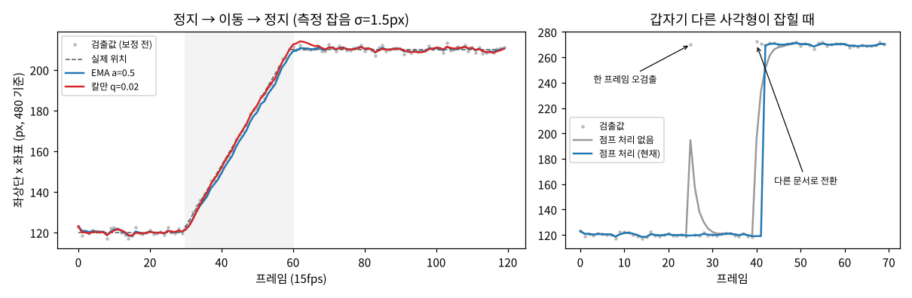

# [tracker] EMA · 칼만 필터 · 급변 처리 · 자동 촬영 판단 비교

- 담당 / 날짜: 신승준 / 11.25
- 질문: 꼭짓점 흔들림을 어떤 방식으로 보정해야 덜 떨리고 덜 뒤처지는가, 오검출이나 문서 전환에 휘둘리지 않는가, 자동 촬영은 제때 되는가
- 방법: `python experiments/tracker_compare.py` (정답 위치를 아는 시뮬레이션, 상황마다 30회 평균)
  - 좌표는 처리 이미지(480px) 기준 px, 1프레임 = 1/15초 (라이브 루프 목표 15fps)
  - 측정 잡음 σ 를 0.5 / 1.5 / 3px 로 바꿔 가며 비교했다. 합성 사진을 30프레임 연속 검출했을 때 보정 전 흔들림은 프레임당 0.2~0.7px였고(저조도가 가장 큼), 실제 카메라는 손떨림·자동초점 때문에 이보다 클 것으로 본다
  - 장면 A: 0~29 정지 → 30~59 초당 45px 이동 → 60~119 정지
  - 장면 B: 40프레임 하나만 150px 떨어진 엉뚱한 사각형 / 장면 C: 40프레임부터 150px 떨어진 다른 문서
  - 비교 대상: 보정 없음, EMA a=0.5 (PR #2 이전과 현재), EMA a=0.3, 칼만 필터(q=0.02), 자동 촬영 판단을 바꾼 [제안] 방식

## 결과

### 흔들림 · 뒤처짐 (장면 A, σ=1.5px)

| 방식 | 정지 시 떨림 | 이동 중 뒤처짐 | 멈춘 직후 오차 |
|---|---|---|---|
| 보정 없음 | 2.63px | 2.96px | 2.89px |
| **EMA a=0.5 (현재 기본)** | **1.07px** | 4.29px | **1.84px** |
| EMA a=0.3 | 0.60px | 8.33px | 2.60px |
| 칼만 q=0.02 | 0.84px | **1.82px** | 2.95px |

- 정지 시 떨림: 보정 없음 대비 EMA 59% 감소, 칼만 68% 감소
- 같은 경향이 σ=0.5, 3 에서도 나왔다 (칼만 이동 중 뒤처짐: σ=0.5 0.75px / σ=3 3.48px, EMA: 3.64px / 5.40px)

### 급변 처리 (장면 B·C, σ=1.5px)

| 방식 | 한 프레임 오검출 시 최대 이탈 | 다른 문서로 전환 | 전환 중 '중간 위치' 프레임 |
|---|---|---|---|
| EMA (PR #2 이전, 점프 처리 없음) | **106.5px** | 5.1프레임 | 4.0 |
| EMA (현재, 점프 처리) | **2.9px** | 2.0프레임 (3번째 프레임에 바로 이동) | 0 |

### 자동 촬영 (장면 A, 멈춘 뒤 2초 안에 자동 촬영된 비율)

| 방식 | σ=0.5 | σ=1.5 | σ=3 | 움직이는 중 잘못 촬영 |
|---|---|---|---|---|
| EMA (현재 판단 방식) | 100% | **33%** | **0%** | 0% |
| 칼만 (현재 판단 방식) | 100% | 27% | 0% | 0~3% |
| [제안] EMA + 창 정지 판정 | 100% | **100%** | 13% | 0% |
| [제안] 칼만 + 창 정지 판정 | 100% | **100%** | 30% | 0% |

## 해석

- **EMA vs 칼만**: 칼만은 속도까지 추정해서 움직일 때 뒤처짐이 EMA의 절반 이하이고 정지 시 떨림도 더 작다. 대신 멈출 때 속도가 남아 살짝 지나쳤다가 돌아온다(멈춘 직후 오차 2.95px vs 1.84px). 사용자는 문서를 비춘 뒤 멈춰서 촬영하므로, 멈춘 직후 정확도가 더 중요하다.
- **급변 처리 (PR #2)**: 처리 전에는 한 프레임 오검출에도 사각형이 100px 넘게 튀었다가 몇 프레임에 걸쳐 돌아왔고, 다른 문서로 옮기면 두 문서 사이 허공에 사각형이 4프레임 떠 있었다. 지금은 오검출 한두 프레임은 무시하고, 새 문서가 3프레임 연속 잡히면 바로 옮겨 간다.
- **자동 촬영이 잘 안 되는 문제 (새로 발견)**: 현재는 '측정값과 보정값의 차이 < 4px' 가 10프레임 연속이어야 촬영한다. 네 꼭짓점 중 하나만 잡음으로 튀어도 카운트가 0으로 돌아가서, 잡음이 1.5px만 돼도 멈춘 뒤 2초 안에 촬영되는 경우가 1/3 밖에 안 된다.
  - [제안] '최근 10프레임 동안 보정된 꼭짓점이 평균 위치에서 반경 3px 안에 머물렀는가' 로 판단하면, 잡음은 프레임마다 쌓이지 않고 움직임은 10프레임 동안 쌓이기 때문에 둘을 구분할 수 있다. σ=1.5 에서 100%, 움직이는 중 잘못 촬영 0%.
  - σ=3 처럼 잡음이 아주 크면 제안 방식도 부족하다. 실기기 흔들림 수준을 먼저 재야 한다.

## 결론

- **기본값은 EMA a=0.5 유지 제안.** 칼만은 이동 중에는 낫지만 멈춘 직후가 더 부정확하고, 문서 스캔은 '멈춘 뒤'가 중요하다. 칼만은 `KalmanCornerTracker` 로 바꿔 쓸 수 있게 남겨 둔다.
- 급변 처리는 PR #2 로 main 에 반영됨 (`jump_tol=40px`, `jump_frames=3`).
- **자동 촬영 판단은 창 방식으로 바꾸는 것을 제안.** 실기기 영상(`python experiments/tracker_video.py <영상>`)에서 보정 전 흔들림 σ 를 재고, 현재 방식이 실제로 촬영이 안 되는지 확인한 뒤 Python·Dart 함께 반영한다.
- 남은 일: 실기기 영상으로 같은 표 다시 만들기 (특히 σ, 자동 촬영 성공률)
